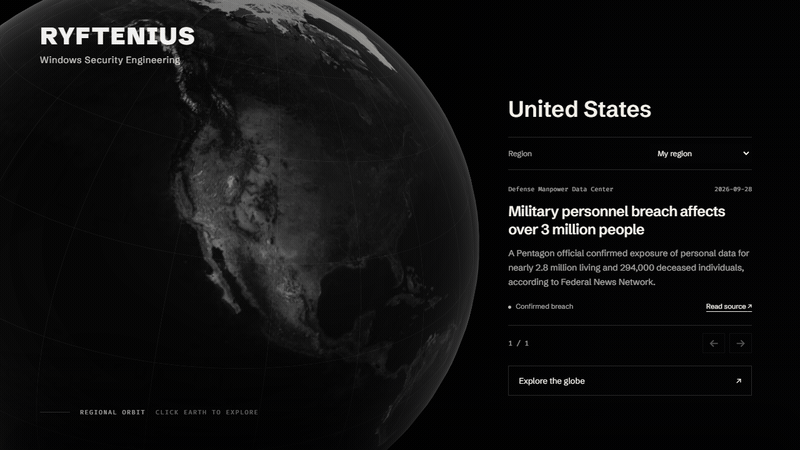

  

<h1 align="center">RYFTENIUS</h1>

  <a href="https://ryftenius.com">Website</a> ·
  <a href="https://ryftenius.com/capability/">Capability</a> ·
  <a href="https://ryftenius.com/research/">Vulnerability Research</a> ·
  <a href="https://ryftenius.com/insight/">Insights</a> ·
  <a href="mailto:contact@ryftenius.com">Contact</a>

---

***What happens when you give specialized researchers & engineers too much time and a motive?***

*They stop asking whether it can be detected and start proving it, **from both ends.***

**Ryftenius** is a specialized R&D collective working on **Windows security from userland to the kernel**, building ***offensive and defensive systems before the problem has a name.***

We use the best tools available, and where they fall short, ***we engineer our own***, from full **detection platforms** to the **offensive tooling** built to defeat them.

Alongside that, we do **[vulnerability research](https://ryftenius.com/research/)** across *reverse-engineering tools*, *endpoint security*, and *the Windows kernel*, coordinated with the vendors who ship them.
